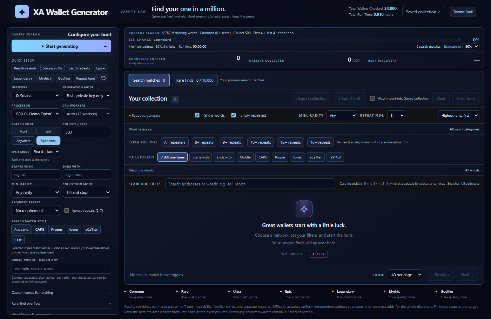
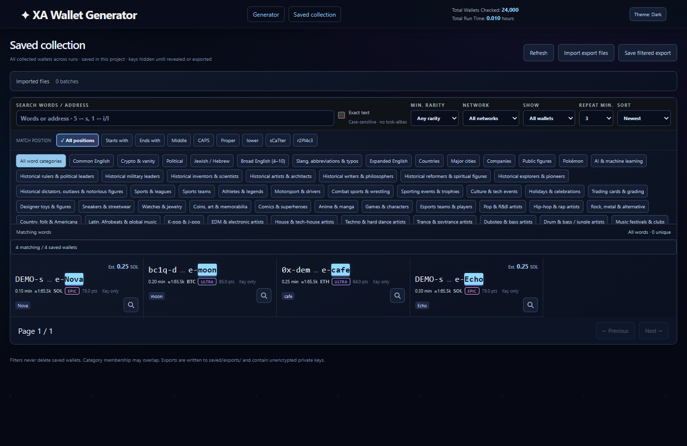

# XA Wallet Generator

XA Wallet Generator generates new vanity wallet addresses locally for Solana, Ethereum/EVM, and Bitcoin mainnet. Choose a word, prefix, suffix, or repeated character to look for, then collect the addresses that match. The app generates fresh keys for each search and makes no blockchain transactions.



## Run locally

Install Node.js 24 or newer. On Windows, double-click **Start XA Wallet Generator.cmd** to install dependencies, build the app, and open it. From a fresh checkout, you can also run these commands and open the [local app](http://127.0.0.1:5173/).

```sh
npm ci
npm run build
npm run preview
```

CPU generation works out of the box. For optional NVIDIA OpenCL acceleration on Windows, install Python and a compatible GPU driver, run **Setup GPU.cmd** once, then restart the local server. Ethereum recovery-phrase generation uses the CPU. Solana and Bitcoin support GPU acceleration in both modes.

## Find an address

1. Choose a network and a generation mode. **Fast** produces a standalone private key. **Recovery phrase** produces a 12-word BIP39 phrase and derives the first account shown below.
2. Choose where to match. For example, select **Solana**, set **Ends with** to `moon`, and choose a collection target. **Fill and stop** ends at that target. **Keep the best** continues replacing lower-scoring matches.
3. Click **Start generating**. Open **Saved collection** to find retained matches across runs, filter by network or word, and export a selection.

| Network | Recovery-mode derivation path | Private key format |
| --- | --- | --- |
| Solana | `m/44'/501'/0'/0'` | Base58 64-byte secret key |
| Ethereum/EVM | `m/44'/60'/0'/0/0` | 32-byte hex private key |
| Bitcoin mainnet | `m/84'/0'/0'/0/0` | Compressed WIF for native SegWit |



Both screenshots use mock data. The displayed addresses are deliberately invalid.

## Wallet storage and sharing

**The local archive and JSON exports contain unencrypted spending keys and, in recovery mode, recovery phrases.** Retained matches are automatically saved under `saved/`. Refreshing the page clears the current view and preserves the archive. Keep backups private, and verify that an imported wallet displays the expected address before funding it. The project has not undergone an independent cryptographic audit.

Run `npm test` for the automated suite. See the [archive guide](docs/archive-storage.md), [word library](docs/word-library.md), and [scoring guide](docs/quality-scoring.md) for details.

## License

Original project code is available under the [Apache License 2.0](LICENSE), except for the derived OpenCL program covered by GPL-3.0. Bundled components and datasets retain their respective terms. See the [GPU license notes](gpu/THIRD_PARTY.md) and [dataset notices](docs/licenses/).
